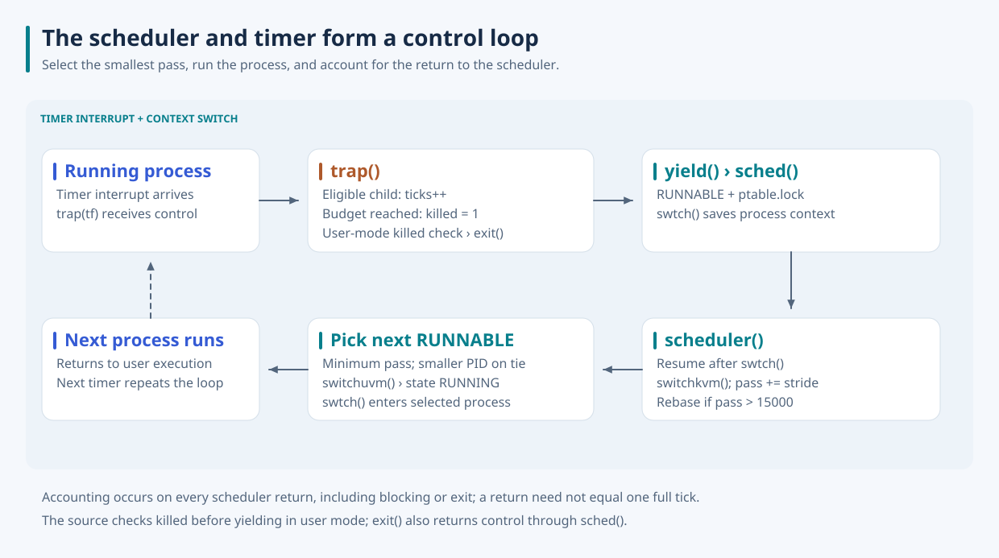
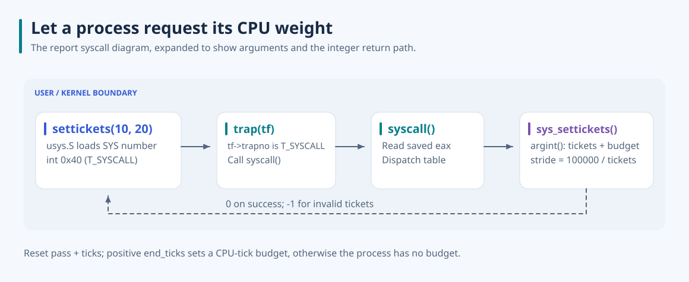

# xv6 Stride Scheduler

**Make CPU scheduling follow an explicit process weight.** I replaced xv6's round-robin selection with a deterministic stride scheduler and added a user interface for setting tickets and a CPU-tick budget.

> **Measured CPU shares:** with 1:2:4 weights, the mean maximum target-share error fell from **23.81 percentage points** on stock round-robin to **0.14 percentage points** with stride scheduling, across five 300-tick runs per kernel. [Method, all samples, and reproduction](docs/measurements.md).

Round-robin treats runnable processes equally. To express unequal shares, each process needs a weight and an accounting value that tells the scheduler how much service it has received. I added tickets, stride, and pass fields, selected the runnable process with the smallest pass, and connected timer interrupts to per-process tick accounting. Execution traces make the selection order, virtual distance, and termination budget visible.


## From tickets to a selection rule

`settickets(tickets, end_ticks)` calculates `stride = 100000 / tickets` using integer division. A larger ticket count gives a smaller stride, so the process's pass advances less after each turn. The scheduler scans `RUNNABLE` entries under `ptable.lock`, chooses the minimum pass, and breaks ties using the smaller PID.

The selected process becomes `RUNNING` and enters through `switchuvm` and `swtch`. When it returns to the scheduler, `switchkvm` restores the kernel address space and its pass increases by its stride. That increment happens on every scheduler return, including blocking and exit; it is not a measurement of the exact CPU time consumed during that turn.

### Bound growing counters

An ever-increasing pass eventually becomes unsafe to compare. I added a rebase when the selected process's updated pass exceeds `PASS_MAX = 15000`: find the minimum pass among current `RUNNABLE` entries, subtract it from that set, then clamp values above `DISTANCE_MAX = 7500`.

Subtracting one baseline preserves differences within that set; clamping large distances loses information. Sleeping and currently running processes are outside the rebase set. The resulting policy bounds runnable counters in the demonstrated workloads, but it does not establish exact long-run proportional fairness across rebases, sleep/wakeup, or multiple CPUs.

## Connect policy to timer-driven execution

The timer path increments a process's `ticks` and sets `killed` at the configured positive budget. The current implementation limits this accounting to processes whose own PID and parent PID are both greater than 2, matching the child workloads in the demo. Eligible processes terminate at the user-mode killed check; otherwise timer preemption calls `yield`, then `sched`, and switches back to the scheduler.



This redraw preserves the report's execution call graph and makes the source's ordering explicit: the killed check before yielding can exit immediately, and an exit also returns control through `sched`. A switch back to the scheduler need not correspond to one complete timer tick.

Newly allocated processes start with tickets 1 and stride 0. Fork inherits the parent's tickets, stride, and pass. A successful `settickets` resets pass and ticks to zero; a non-positive budget disables budget-based termination. Consequently, processes that never call `settickets` do not receive the usual `100000 / tickets` stride, and repeated resets can affect relative service. These are limits of the current scheduling policy.

## Run and inspect the traces

Use Linux or WSL with Make, a compiler supporting 32-bit x86 code, binutils, and QEMU. The documented run used GCC 9 and one virtual CPU to make selection order easy to follow.

```bash
cd xv6-public
make CC=gcc-9 xv6.img fs.img
make CC=gcc-9 CPUS=1 qemu-nox
```

At the xv6 shell:

```text
scheduler_test
```

The bundled executable runs five workloads. Each timer trace prints the selected PID, stride, tickets, the projected pass transition, and `ticks/end_ticks`. With equal 1,000-ticket children, the fresh run selected PIDs 4, 5, and 6 in turn with stride 100 until each reached its 20-tick budget. Unequal-ticket workloads showed smaller strides receiving more selections before the lower-weight children caught up. Low-ticket workloads exercised repeated rebasing and the 7,500 distance clamp. All five workloads reached their end markers and returned to the shell.

These traces reproduce the report's scheduling and termination demonstrations. The separate [controlled CPU-share comparison](docs/measurements.md) measures a fixed three-worker window against stock round-robin. Scheduling changes when a workload finishes or becomes runnable. Exit QEMU with **Ctrl+A, then X**.

The source for `_scheduler_test`, `_debug_test`, and `_syscall_test` is absent from this repository: their prebuilt xv6 executables are checked in and included in the filesystem image. The Makefile's clean rule preserves them, but their internals cannot be rebuilt or reviewed here. Kernel source and the ordinary xv6 user programs do build from source.

## Source and user interface

The policy and fork initialization are in [proc.c](xv6-public/proc.c); scheduling fields and constants are in [proc.h](xv6-public/proc.h). Timer accounting and exit checks are in [trap.c](xv6-public/trap.c). The user/kernel path for requesting a weight is:



The call is `int settickets(int tickets, int end_ticks)`. Valid tickets are `1..100000`; success returns `0`, invalid tickets return `-1`. The wiring is in [user.h](xv6-public/user.h), [usys.S](xv6-public/usys.S), [syscall.h](xv6-public/syscall.h), [syscall.c](xv6-public/syscall.c), and [sysproc.c](xv6-public/sysproc.c). The report labels the software interrupt `0x80`; xv6's actual `T_SYSCALL` value is 64, or `0x40`, which the redraw uses.

Both report diagrams are preserved as redesigned SVGs; the worked stride example is an additional explanatory figure. Labels use outlined Noto Sans with its [font license](docs/assets/NotoSans-OFL.txt). Original reports are not included. Upstream information remains in [xv6-public/README](xv6-public/README); see the [collection](https://github.com/jaeunda/xv6-kernel-extensions) for the other extensions.
