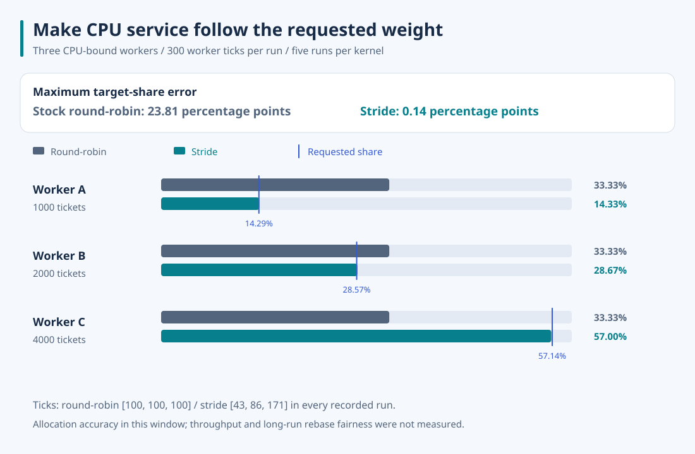

# Measuring whether CPU service follows the requested weights

**Stride scheduling brought a 1:2:4 CPU allocation close to its target.** I ran the same three CPU-bound workers on stock xv6 round-robin and this stride scheduler, then compared their measured service with the requested shares.



## Result

| Worker | Requested tickets | Target share | Stock round-robin | Stride |
| --- | ---: | ---: | ---: | ---: |
| A | 1,000 | 14.29% | 100 / 300 ticks · 33.33% | 43 / 300 ticks · 14.33% |
| B | 2,000 | 28.57% | 100 / 300 ticks · 33.33% | 86 / 300 ticks · 28.67% |
| C | 4,000 | 57.14% | 100 / 300 ticks · 33.33% | 171 / 300 ticks · 57.00% |
| Maximum absolute target-share error | | | **23.81 percentage points** | **0.14 percentage points** |

Each kernel ran five times, with a fresh QEMU boot for each run. All five stock runs returned `[100, 100, 100]`; all five stride runs returned `[43, 86, 171]`. The mean of the maximum per-worker error was therefore 23.8095 versus 0.1429 percentage points. [All samples and environment details](measurements.json) preserve the unrounded values.

The metric is `max_i(abs(100 × worker_ticks[i] / 300 - target_percent[i]))`, averaged across the five runs. Stock round-robin provides equal turns and has no ticket API; its distance from an unequal target is the behavior this extension changes. The comparison measures allocation accuracy, not greater total CPU capacity, faster execution, or a general-purpose speedup.

## Controlled workload and instrumentation

A parent creates three children. Each stride child calls `settickets(1000 << i, -1)` before reporting readiness; a pipe barrier releases them after all are ready. They then run the same nonblocking increment loop. The parent enters a measurement-only syscall and sleeps while an identical timer hook counts interrupts charged to the three worker PIDs. Sampling ends after 300 worker ticks; the parent wakes, kills the workers, waits for them, and prints the counts. Parent, shell, and idle ticks are excluded from the denominator.

The runner adds this hook and syscall only to temporary copies of both kernels. It disables this extension's per-tick serial debug printing in the measurement copy, so diagnostic output does not compete with the workload. Selection, pass increments, rebasing, ticket validation, and normal termination rules are unchanged. The ordinary repository build does not include the measurement hook.

This window uses integer strides 100, 50, and 25, one virtual CPU, and continuously runnable workers. It establishes proportional service for this short, controlled case. Integer rounding with other weights, sleeping and waking workers, repeated ticket resets, the lossy rebase clamp, and multiple CPUs can change the result. The sampled timer ticks also include any setup/syscall work that falls in the window; they are a discrete service measure, not a high-resolution timing profile.

## Reproduce

Install Python 3, Make, binutils, GCC 9 with 32-bit x86 output, and `qemu-system-i386`. The recorded environment used GCC 9.5.0, QEMU 8.2.2 with its default software emulation, one virtual CPU, and 512 MiB guest RAM. Start in this repository's root:

```bash
git clone https://github.com/mit-pdos/xv6-public.git /tmp/xv6-stock
git -C /tmp/xv6-stock checkout eeb7b415dbcb12cc362d0783e41c3d1f44066b17
python3 xv6-public/benchmarks/measure.py \
  --baseline /tmp/xv6-stock \
  --output /tmp/xv6-share-result \
  --runs 5
```

The output directory must not exist. The runner checks the pinned baseline and writes the temporary builds, disk images, build logs, all ten guest transcripts, and `results.json` there. [Guest workload](../xv6-public/benchmarks/share.c) · [Timer hook](../xv6-public/benchmarks/tick_hook.c) · [Runner](../xv6-public/benchmarks/measure.py) · [Pinned upstream](https://github.com/mit-pdos/xv6-public/tree/eeb7b415dbcb12cc362d0783e41c3d1f44066b17).
